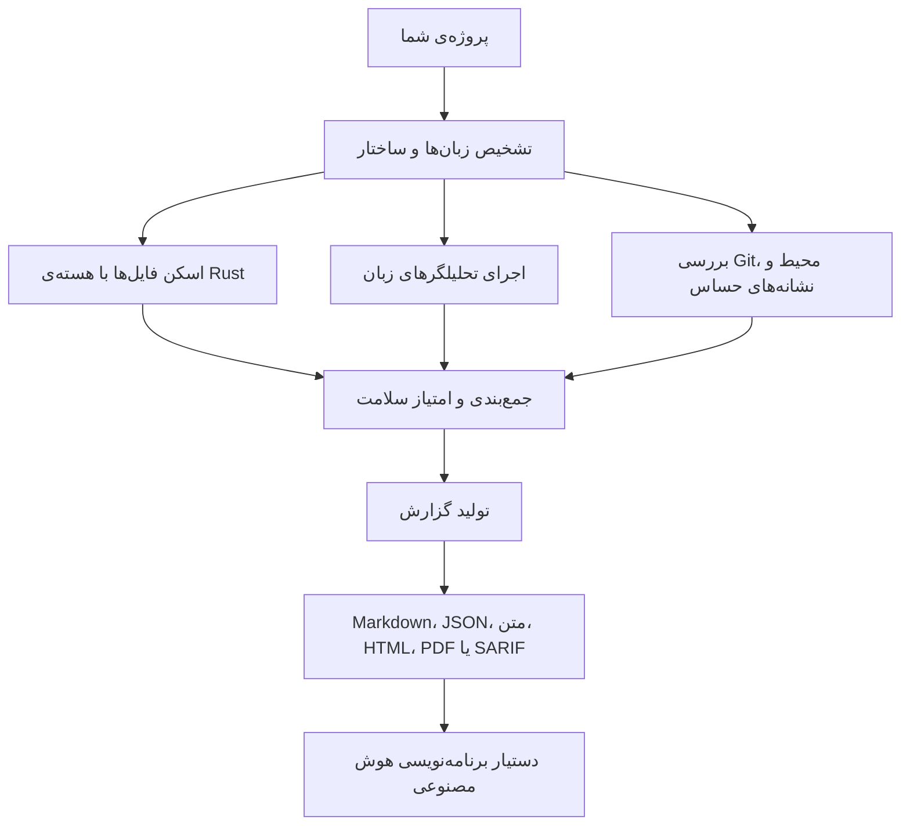

<h1 align="center"></h1>

<p align="center">
  <a href="README.md">English</a> · <strong>فارسی</strong>
</p>

<p align="center">
  <a href="https://github.com/msoleimani62/sarand/actions/workflows/ci.yml"></a>
  <a href="https://github.com/msoleimani62/sarand/tags"></a>
  
  
  
  <a href="LICENSE"></a>
</p>

<div dir="rtl">

<p align="center">
  <strong>سرند، شناخت پروژه پیش از شروع کدنویسی با هوش مصنوعی</strong>
</p>

<p align="center">
  <a href="#quick-start">شروع سریع</a> ·
  <a href="#install">نصب</a> ·
  <a href="#usage">دستورها</a> ·
  <a href="#report">گزارش خروجی</a> ·
  <a href="#security">امنیت</a> ·
  <a href="#more-tools">ابزارهای جانبی</a> ·
  <a href="#troubleshooting">عیب‌یابی</a> ·
  <a href="#uninstall">حذف نصب</a>
</p>

---

> **این پروژه با [Sarand](https://github.com/beiko-lab/sarand) اشتباه گرفته نشود.** آن پروژه ابزاری بیوانفورماتیکی برای بررسی همسایگی ژن‌های مرتبط با مقاومت ضدمیکروبی است؛ این مخزن، ابزاری مستقل برای توسعه‌دهندگان نرم‌افزار است.

سرند (`sarand`) پروژه‌ی شما را بررسی می‌کند، زبان‌ها و ابزارهای به‌کاررفته را تشخیص می‌دهد و در صورت وجود ابزارهای لازم، آزمون‌ها و بررسی‌های کیفیت و امنیت را اجرا می‌کند. سپس نتیجه‌ها را در **یک گزارش یکپارچه** می‌نویسد؛ گزارشی شامل ساختار پروژه، فایل‌های منبع، نتیجه‌ی بررسی‌ها، امتیاز سلامت و خلاصه‌ای برای دستیارهای برنامه‌نویسی هوش مصنوعی.

اگر می‌خواهید پروژه‌ای را به یک دستیار هوش مصنوعی بسپارید، سرند کمک می‌کند دستیار به‌جای حدس‌زدن درباره‌ی ساختار و وضعیت کد، با اطلاعات منظم‌تری کار را شروع کند.

## چرا سرند؟

<table>
  <tr>
    <td width="50%" valign="top"><strong>یک دستور، یک گزارش</strong><br>ساختار پروژه، کدها، نتیجه‌ی آزمون‌ها، خروجی ابزارهای کیفیت، یافته‌های امنیتی و امتیاز سلامت در یک فایل جمع می‌شوند. قالب‌های خروجی شامل Markdown، JSON، متن ساده، HTML، PDF و SARIF هستند.</td>
    <td width="50%" valign="top"><strong>گزارش مناسب دستیار هوش مصنوعی</strong><br>گزارش، خلاصه‌ای از پروژه و ترتیب پیشنهادی مطالعه‌ی فایل‌ها را هم در بر می‌گیرد تا مدل بتواند بررسی را از بخش‌های مهم‌تر شروع کند.</td>
  </tr>
  <tr>
    <td valign="top"><strong>پوشش زبان‌ها و قالب‌های گوناگون</strong><br>سرند ده‌ها زبان و قالب، از Python و Rust تا Java، Kotlin، C/C++، JavaScript، Terraform و فایل‌های Kubernetes را شناسایی یا بررسی می‌کند. جزئیات در <a href="https://github.com/msoleimani62/sarand/blob/main/docs/COVERAGE.md">ماتریس پوشش</a> آمده است.</td>
    <td valign="top"><strong>مراقبت از فایل‌های حساس</strong><br>فایل‌هایی که در آن‌ها راز یا اطلاعات شبیه اعتبارنامه تشخیص داده شود، وارد گزارش نمی‌شوند. گزینه‌ی <code>--security</code> بررسی رازها در تاریخچه‌ی Git را نیز فعال می‌کند.</td>
  </tr>
  <tr>
    <td valign="top"><strong>هسته‌ی سریع با جایگزین پایتونی</strong><br>بخش سنگین اسکن با هسته‌ی Rust انجام می‌شود. اگر این هسته در دسترس نباشد، سرند می‌تواند از اسکنر پایتون خالص استفاده کند؛ این حالت ممکن است کندتر باشد.</td>
    <td valign="top"><strong>قابل استفاده در چند سیستم‌عامل</strong><br>سرند برای Linux، macOS، Windows و محیط ترمینالی Android/Termux طراحی شده است. اجرای CI دسکتاپ روی Linux، macOS و Windows انجام می‌شود؛ این موضوع به معنی تأیید همه‌ی قابلیت‌ها روی هر دستگاه Android نیست.</td>
  </tr>
</table>

<a id="quick-start"></a>

## شروع سریع

### ۱. نصب

به Python نسخه‌ی ۳٫۱۱ یا جدیدتر و ابزار `pipx` نیاز دارید. برای نصب معمول از PyPI به Rust احتیاجی نیست، چون بسته‌های ازپیش‌ساخته‌شده برای پلتفرم‌های پشتیبانی‌شده منتشر می‌شوند.

<div dir="ltr">

```bash
pipx install sarand-cli
sarand --version
```

</div>

### ۲. ساخت گزارش

به پوشه‌ی پروژه بروید و سرند را اجرا کنید:

<div dir="ltr">

```bash
cd ~/my-project
sarand --full
```

</div>

گزینه‌ی `--full` بررسی‌های کیفیت و امنیت را هم فعال می‌کند و محدودیت‌های معمول برای اندازه‌ی فایل‌ها و پیمایش ساختار پروژه را برمی‌دارد؛ بنابراین روی پروژه‌های بزرگ ممکن است زمان و حافظه‌ی بیشتری مصرف کند.

گزارش به‌طور پیش‌فرض در پوشه‌ی `~/Downloads` ذخیره می‌شود. مسیر نهایی در انتهای خروجی ترمینال نمایش داده خواهد شد.

> [!WARNING]
> اسکن یک پروژه، مجموعه‌تست خودِ آن پروژه را اجرا می‌کند (و با `--quality`، `--security` یا `--full` ابزارهای lint و audit آن را هم). پس اسکن پروژه‌ای که به آن اعتماد ندارید یعنی اجرای کد آن. جزئیات در [مدل اعتماد](#trust-model) آمده است؛ دستور `sarand --skip-tests` به‌تنهایی هیچ ابزاری از پروژه را اجرا نمی‌کند.

### ۳. بررسی ابزارهای نصب‌شده

اگر می‌خواهید بدانید کدام ابزارهای بررسی روی سیستم شما وجود دارند و کدام‌یک نصب نیستند، این دستور را اجرا کنید:

<div dir="ltr">

```bash
sarand --doctor
```

</div>

ابزارهای هر زبان اختیاری‌اند. اگر ابزاری نصب نباشد، بررسی وابسته به آن معمولاً با وضعیت «اجرا نشد» ثبت می‌شود و سرند راه نصب آن را نشان می‌دهد؛ نبودن ابزار به‌خودی‌خود نباید با موفقیت بررسی اشتباه گرفته شود.

## سرند چگونه کار می‌کند؟

<div dir="ltr">



</div>

پیمایش فایل‌ها، شمارش خط‌ها و هش‌کردن فایل‌ها در یک افزونه‌ی Rust انجام می‌شود که از طریق [PyO3](https://pyo3.rs) و [maturin](https://www.maturin.rs) به پایتون متصل است. تحلیلگرها، قالب‌های گزارش، امتیاز سلامت و رابط خط فرمان با پایتون پیاده‌سازی شده‌اند.

اگر افزونه‌ی کامپایل‌شده‌ی Rust ساخته یا بارگذاری نشود، سرند به اسکنر پایتون خالص برمی‌گردد. گزارش همچنان تولید می‌شود، اما اسکن ممکن است کندتر باشد.

<a id="report"></a>

## گزارش خروجی چه چیزهایی دارد؟

| بخش گزارش | توضیح |
|---|---|
| پروژه‌ی شناسایی‌شده | زبان‌ها، ابزارهای ساخت و نقاط ورود برنامه |
| محیط اجرا | سیستم‌عامل، پردازنده، حافظه و نسخه‌ی ابزارهای اصلی |
| Git | شاخه‌ی فعال، وضعیت تغییرات و تاریخچه‌ی اخیر |
| امتیاز سلامت | امتیاز صفر تا ۱۰۰، درجه و پیشنهادهای بهبود |
| خلاصه‌ی هوش مصنوعی | مرور پروژه و ترتیب پیشنهادی برای مطالعه‌ی فایل‌ها |
| آمار پروژه | تعداد فایل‌ها، تعداد خط‌ها و سهم زبان‌های مختلف |
| TODO و FIXME | نشانه‌های باقی‌مانده در کد به‌همراه محل آن‌ها |
| نتیجه‌ی آزمون‌ها | موفقیت یا شکست آزمون‌ها و خروجی ابزارهای اجراشده |
| بررسی کیفیت | نتیجه‌ی ابزارهای lint، قالب‌بندی و بررسی نوع، با `--quality` |
| بررسی امنیت | یافته‌های امنیتی و بررسی وابستگی‌ها، با `--security` |
| مشکلات شناخته‌شده | خطاها و مسئله‌هایی که از خروجی ابزارها تشخیص داده شده‌اند |
| ساختار و محتوای فایل‌ها | درخت پروژه و محتوای فایل‌های مجاز؛ با `--no-source` محتوای فایل‌ها درج نمی‌شود |

### کدام ابزارها اجرا می‌شوند؟

سرند ابزارهای رایج هر اکوسیستم را اجرا می‌کند. فهرست زیر نمونه‌ای از ابزارهای پشتیبانی‌شده است؛ اجرای واقعی هر بررسی به نوع پروژه و نصب‌بودن ابزار مربوط بستگی دارد.

| زبان یا اکوسیستم | ابزارهای آزمون، کیفیت یا امنیت |
|---|---|
| Python | آزمون: `pytest`؛ کیفیت: `ruff` و `mypy`؛ امنیت: `pip-audit` و `bandit` |
| Rust | آزمون: `cargo`؛ کیفیت: `rustfmt` و `cargo-clippy`؛ امنیت: `cargo-audit` و `cargo-deny` |
| Go | آزمون: `go`؛ کیفیت: `staticcheck`؛ امنیت: `govulncheck` |
| Node.js | آزمون: `npm`؛ کیفیت: `eslint` |
| TypeScript | کیفیت: `tsc` |
| CSS | کیفیت: `stylelint` |
| Zig | آزمون: `zig`؛ کیفیت: `zig fmt` |
| Assembly | تشخیص داخلی گویش فایل‌ها، بدون نیاز به ابزار خارجی |
| Swift | آزمون: `swift` و `xcodebuild`؛ کیفیت: `swift-format` و `swiftlint` |
| SQL | کیفیت: `sqlfluff` |
| C/C++ | تشخیص: `cmake`؛ کیفیت: `clang-tidy`؛ امنیت: `cppcheck` |
| Java / Kotlin / Android | آزمون: `mvn` و `gradle`؛ در صورت وجود از `./gradlew` استفاده می‌شود؛ کیفیت: Checkstyle و SpotBugs |
| Lua | آزمون: `busted`؛ کیفیت: `luacheck` |
| Ruby | آزمون: `bundle`؛ کیفیت: `rubocop`؛ امنیت: `bundler-audit` (همه با `bundle exec`) |
| PHP | بررسی امنیت وابستگی‌ها با `composer` |
| Dart / Flutter | آزمون: `dart` |
| Kotlin | کیفیت: `ktlint` و `detekt` |
| C# | آزمون: `dotnet`؛ کیفیت: `dotnet format`؛ امنیت: `dotnet list package` |
| Shell | آزمون: `bats`؛ کیفیت: `shellcheck` و `shfmt` |
| YAML | کیفیت: `yamllint` |
| Markdown | کیفیت: `markdownlint` |
| JSON | کیفیت: `jsonlint` |
| TOML | کیفیت: `taplo` |
| XML | کیفیت: `xmllint` |
| R | آزمون: `Rscript` |
| Perl | آزمون: `prove`؛ کیفیت: `perlcritic` |
| Julia | آزمون: `julia` |
| Objective-C | آزمون: `xcodebuild` |
| Groovy | کیفیت: `codenarc` |
| PowerShell | آزمون: `pwsh` |
| Nix | آزمون: `nix`؛ کیفیت: `nixpkgs-fmt` |
| Haskell | آزمون: `stack` و `cabal`؛ کیفیت: `hlint` |
| Elixir | ابزار `mix` برای آزمون، کیفیت و امنیت؛ Credo و MixAudit در صورت وابستگی پروژه |
| Erlang | ابزار `rebar3` برای آزمون‌های EUnit و بررسی xref |
| Scala | آزمون: `sbt`؛ قالب‌بندی با `scalafmt` از طریق `sbt`، در صورت استفاده‌ی پروژه |
| Dockerfile | کیفیت: `hadolint` |
| Kubernetes | `helm lint` برای هر Chart و `kustomize build` برای هر Overlay |
| GitHub Actions | کیفیت: `actionlint` |
| Terraform | `terraform fmt` و `tflint`؛ دستورهای `init`، `plan` و `apply` اجرا نمی‌شوند |
| Protobuf | کیفیت: `buf lint` |

سرند علاوه بر زبان‌های بالا، قالب‌هایی مانند JavaScript، PHP، Ruby، Dart، Elixir، Erlang، Scala، فایل‌های پیکربندی و قالب‌های زیرساخت را نیز شناسایی می‌کند. برای فهرست دقیق و به‌روز، [ماتریس پوشش](https://github.com/msoleimani62/sarand/blob/main/docs/COVERAGE.md) را ببینید.

### تشخیص فایل‌های اسمبلی

برای تشخیص فایل‌های اسمبلی به ابزار خارجی نیاز نیست. سرند پسوندهایی مانند `.asm`، `.s`، `.S`، `.nasm`، `.yasm`، `.masm`، `.fasm`، `.a51`، `.a65`، `.a86` و `.z80` را در ریشه‌ی پروژه و پوشه‌های سطح اولی مانند `src/`، `asm/`، `boot/`، `kernel/` و `firmware/` بررسی می‌کند.

گویش‌های قابل‌شناسایی شامل موارد زیرند:

- **x86:** ‏NASM، ‏GNU as با نحو AT&T یا Intel، ‏MASM/TASM و FASM؛ در حالت‌های ۱۶، ۳۲ و ۶۴ بیتی.
- **ARM و AArch64:** ‏A32/T32 و A64.
- **معماری‌های دیگر:** ‏RISC-V، ‏MIPS، ‏PowerPC، ‏6502، ‏Z80، ‏AVR، ‏Motorola 68000 و ‏8051.

این قابلیت بر پایه‌ی قواعد تشخیص است، نه یک تجزیه‌گر کامل اسمبلی. اگر سرند نتواند گویش فایلی را با اطمینان تشخیص دهد، آن را `Unidentified` گزارش می‌کند؛ هیچ فایلی اسمبل یا اجرا نمی‌شود.

### خروجی PDF

برای تولید PDF، سرند به موتور تبدیل HTML به PDF نیاز دارد: `wkhtmltopdf` یا `WeasyPrint`. پروژه‌ی بالادستی `wkhtmltopdf` در سال ۲۰۲۳ بایگانی شده و ممکن است بسته‌ی آن در بعضی توزیع‌ها موجود نباشد. برای نصب WeasyPrint در محیط pipx می‌توانید از دستور زیر استفاده کنید:

<div dir="ltr">

```bash
pipx inject sarand-cli weasyprint
```

</div>

WeasyPrint به کتابخانه‌ی سیستمی Pango هم نیاز دارد. اگر هیچ موتور PDF قابل استفاده نباشد، سرند دلیل را اعلام می‌کند، گزارش Markdown را کنار مسیر PDF می‌نویسد و با کد خروج غیرصفر تمام می‌شود. این دو موتور روی Termux و Android تأیید نشده‌اند؛ در این محیط‌ها می‌توانید از `--format html` استفاده کنید و گزارش را از مرورگر چاپ بگیرید.

<a id="install"></a>

## نصب

### پیش‌نیازها

| پیش‌نیاز | کاربرد |
|---|---|
| Python نسخه‌ی ۳٫۱۱ یا جدیدتر | اجرای سرند |
| `pipx` | روش پیشنهادی برای نصب مستقل از پروژه‌های پایتون دیگر |
| زنجیره‌ابزار Rust | فقط برای ساخت از سورس؛ نصب معمول از PyPI به آن نیاز ندارد |
| ابزارهای هر زبان | اختیاری؛ برای اجرای آزمون‌ها و بررسی‌های تخصصی |

### نصب از PyPI

این روش برای بیشتر کاربران مناسب است:

<div dir="ltr">

```bash
pipx install sarand-cli
sarand --version
```

</div>

نام بسته در PyPI، برابر `sarand-cli` است؛ فرمانی که پس از نصب اجرا می‌کنید `sarand` نام دارد. این دو نام را با هم اشتباه نگیرید. نام `sarand` در PyPI به پروژه‌ی دیگری تعلق دارد.

بسته‌های ازپیش‌ساخته‌شده برای Linux مبتنی بر glibc در معماری‌های x86_64 و aarch64، برای macOS روی پردازنده‌های Intel و Apple silicon و برای Windows روی x64 منتشر می‌شوند. در سیستم‌های دیگر ممکن است نصب به ساخت بسته از سورس نیاز داشته باشد.

برای ارتقا به نسخه‌ی جدید:

<div dir="ltr">

```bash
pipx upgrade sarand-cli
```

</div>

### نصب از سورس با pipx

اگر مخزن را دریافت کرده‌اید، `pipx` می‌تواند پروژه را در محیطی جدا نصب کند:

<div dir="ltr">

```bash
pipx install ~/sarand
sarand --version
```

</div>

برای به‌روزرسانی نسخه‌ای که از سورس نصب شده است، از اسکریپت نصب خود پروژه استفاده کنید. اجرای دوباره‌ی `pipx install` به‌تنهایی لزوماً نسخه‌ی موجود را با سورس جدید جایگزین نمی‌کند.

<div dir="ltr">

```bash
cd ~/sarand
./install.sh
```

</div>

اسکریپت ابتدا نسخه‌ی فعلی سورس را می‌سازد و پس از موفقیت، نصب قبلی را جایگزین می‌کند. اگر ساخت ناموفق باشد، نصب قبلی حفظ یا بازیابی می‌شود. در پایان، نسخه‌ی نصب‌شده را اعلام می‌کند و اگر فرمان دیگری از مسیر `PATH` اجرا شود، هشدار می‌دهد. اگر پیش از نسخه‌ی ۰٫۶٫۱۹ سرند را با نام قدیمی `sarand` در pipx نصب کرده‌اید، اسکریپت آن نصب را هم کنار می‌گذارد و فقط پس از ساخت موفق جایگزین می‌کند.

### نصب pipx

در صورت نصب‌نبودن `pipx`، روش پیشنهادی استفاده از مدیر بسته‌ی سیستم‌عامل است:

<div dir="ltr">

```bash
sudo pacman -S python-pipx
```

</div>

در macOS می‌توانید از Homebrew و در توزیع‌های Debian/Ubuntu از `apt` استفاده کنید:

<div dir="ltr">

```bash
brew install pipx
sudo apt install pipx
```

</div>

روش جایگزین با pip:

<div dir="ltr">

```bash
python3 -m pip install --user pipx
pipx ensurepath
```

</div>

پس از تغییر `PATH`، ترمینال را دوباره باز کنید. در سیستم‌هایی که نصب مستقیم در Python سیستمی را محدود می‌کنند (PEP 668)، بهتر است از مدیر بسته یا محیط مجازی استفاده کنید؛ گزینه‌ی `--break-system-packages` را بدون ضرورت به کار نبرید.

### Arch Linux و AUR

بسته‌ی AUR در وضعیت فعلی این مستندات هنوز منتشر نشده است؛ بنابراین روی نصب از طریق `yay -S sarand` حساب نکنید و از روش `pipx` استفاده کنید.

### نصب برای توسعه

برای ساخت افزونه‌ی Rust و کار روی سورس، به زنجیره‌ابزار Rust و `maturin` نیاز دارید:

<div dir="ltr">

```bash
python3 -m pip install maturin
cd sarand
maturin develop --release
```

</div>

نصب و ساخت توسعه‌ای با `pip install -e .` بدون ابزار ساخت مناسب ممکن است شکست بخورد، چون افزونه‌ی Rust باید کامپایل شود. اگر ساخت افزونه روی سیستم شما ممکن نیست، می‌توانید سرند را مستقیماً از درخت سورس و با اسکنر پایتون خالص اجرا کنید.

<div dir="ltr">

```bash
python3 -m venv .venv
. .venv/bin/activate
python -m pip install rich PyYAML filelock
PYTHONPATH=python python -m sarand --help
```

</div>

برای تحلیل یک پروژه با نسخه‌ی موجود در سورس:

<div dir="ltr">

```bash
PYTHONPATH=/path/to/sarand/python python -m sarand -p .
```

</div>

<details>
<summary><strong>نکته‌های مربوط به Windows، macOS و Android/Termux</strong></summary>

<br>

- **Windows:** فایل `install.sh` یک اسکریپت Bash است. در PowerShell، از داخل مخزن دستور `pipx install .` را اجرا کنید.
- **macOS:** می‌توانید `pipx` را با Homebrew نصب و مراحل نصب PyPI را دنبال کنید.
- **Android/Termux:** اجرای ترمینالی سرند ممکن است، اما پشتیبانی هر موتور و ابزار خارجی به محیط شما بستگی دارد. ابزار انتقال گزارش به چت از دنباله‌ی ترمینالی OSC 52 برای کپی در کلیپ‌بورد استفاده می‌کند و برای این کار به محیط گرافیکی نیاز ندارد.

</details>

<a id="usage"></a>

## دستورهای پرکاربرد

| کاربرد | دستور |
|---|---|
| تحلیل پوشه‌ی فعلی | `sarand` |
| تحلیل پروژه‌ای دیگر و اجرای بررسی کیفیت | `sarand --project ~/my-project --quality` |
| تولید گزارش کامل‌تر | `sarand --full` |
| اجرای بررسی‌های امنیتی | `sarand --security` |
| صرف‌نظر از بررسی‌های زمان‌بر پایگاه‌های آسیب‌پذیری | `sarand --security --skip-audit` |
| تولید JSON بدون اجرای آزمون‌ها | `sarand --skip-tests --format json -o report.json` |
| تولید PDF | `sarand --format pdf` |
| تولید خروجی مناسب ابزارهای اسکن کد | `sarand --security --format sarif` |
| نیاوردن محتوای فایل‌ها در گزارش | `sarand --no-source` |
| محدودکردن اندازه‌ی فایل‌های درج‌شده | `sarand --full --max-file-size 1M` |
| تعیین پوشه‌ی خروجی پیش‌فرض | `sarand --set-output-dir ~/ai-reports` |
| استفاده از کش برای اجراهای بعدی | `sarand --cache` |
| بررسی وضعیت ابزارها و محیط | `sarand --doctor` |

### گزینه‌ی `--full` دقیقاً چه می‌کند؟

این گزینه، `--quality` و `--security` را فعال می‌کند و محدودیت‌های پیش‌فرض مربوط به اندازه‌ی فایل، عمق درخت و تعداد ورودی‌های درخت را برمی‌دارد. اگر خودتان گزینه‌هایی مانند `--max-depth`، `--max-entries` یا `--max-file-size` را تعیین کنید، مقدار صریح شما اولویت دارد.

اجرای دوباره‌ی سرند روی همان پروژه، گزارش قبلی را در همان مسیر جایگزین می‌کند و این موضوع را در خروجی اعلام می‌کند.

### پروژه‌های بزرگ و دستگاه‌های کم‌حافظه

پیش از ساخت گزارش، سرند حجم تقریبی کدی را که قرار است در گزارش درج شود اعلام می‌کند و در صورت زیادبودن حجم نسبت به حافظه‌ی آزاد، هشدار می‌دهد. این هشدار اجرای برنامه را متوقف نمی‌کند؛ بااین‌حال، گزارش کامل یک پروژه‌ی بزرگ ممکن است روی گوشی یا لپ‌تاپ کم‌حافظه کند شود یا با کمبود حافظه روبه‌رو شود.

برای سبک‌ترکردن گزارش می‌توانید:

- گزینه‌ی `--no-source` را به کار ببرید تا محتوای فایل‌ها درج نشود.
- با `--max-file-size` اندازه‌ی هر فایل قابل درج را محدود کنید.
- در صورت نیازنداشتن به همه‌ی بررسی‌ها، از `--full` استفاده نکنید.

محدودیت پیش‌فرض اندازه‌ی فایل `2M` است؛ `--full` این محدودیت را برمی‌دارد، مگر اینکه خودتان مقدار دیگری تعیین کنید.

<details>
<summary><strong>فهرست کامل گزینه‌های خط فرمان</strong></summary>

<br>

| گزینه | کاربرد |
|---|---|
| `-p, --project PATH` | مسیر ریشه‌ی پروژه؛ پیش‌فرض، پوشه‌ی فعلی است |
| `-d, --output-dir PATH` | پوشه‌ای که گزارش در آن ذخیره می‌شود |
| `-o, --output-name NAME` | نام فایل گزارش؛ پیش‌فرض `sarand-<project>-report.<ext>` است |
| `--set-output-dir PATH` | ذخیره‌ی مسیر به‌عنوان پوشه‌ی پیش‌فرض گزارش و سپس خروج |
| `-f, --format FORMAT` | قالب خروجی: `markdown`، `json`، `text`، `html`، `pdf` یا `sarif` |
| `--skip-tests` | اجرا نکردن آزمون‌ها |
| `--quality` | اجرای ابزارهای کیفیت، قالب‌بندی و بررسی نوع برای زبان‌های تشخیص‌داده‌شده |
| `--security` | اجرای بررسی‌های امنیتی و آسیب‌پذیری |
| `--skip-audit` | صرف‌نظر از بررسی‌های `pip-audit` و `cargo-audit` |
| `--full` | فعال‌کردن کیفیت و امنیت و برداشتن محدودیت‌های پیش‌فرض اسکن |
| `--max-depth N` | حداکثر عمق پیمایش درخت پروژه |
| `--max-entries N` | حداکثر تعداد ورودی‌ها در هر سطح درخت |
| `--max-file-size SIZE` | حداکثر اندازه‌ی فایل قابل درج؛ مانند `512K`، `2M` یا `1G` |
| `--no-source` | حذف محتوای فایل‌ها از گزارش |
| `--no-health` | محاسبه‌نکردن امتیاز سلامت |
| `--cache` | استفاده از کش برای کاهش اسکن دوباره‌ی TODOها و رازهای فایل‌های تغییرنکرده |
| `--clear-cache` | پاک‌کردن کش اسکن پروژه و خروج |
| `--doctor` | بررسی محیط و ابزارهای نصب‌شده و خروج |
| `-v, --verbose` و `--debug` | نمایش جزئیات بیشتر در گزارش اجرای برنامه |
| `--version` | نمایش نسخه و هشدار درباره‌ی نصب توسعه‌ای قدیمی، در صورت تشخیص |

</details>

<a id="security"></a>

## بررسی‌های امنیتی

گزینه‌ی `--security` ابزارهای امنیتی مرتبط با زبان‌های شناسایی‌شده را اجرا می‌کند؛ برای نمونه `bandit` و `pip-audit` برای Python، ‏`cargo-audit` و `cargo-deny` برای Rust و `govulncheck` برای Go. علاوه بر آن، چند بررسی در سطح کل پروژه انجام می‌شود.

| بررسی | کارکرد |
|---|---|
| جست‌وجوی اطلاعات حساس | ابزار `gitleaks` در فایل‌های فعلی و تاریخچه‌ی Git به دنبال کلیدها، رمزها و اعتبارنامه‌های احتمالی می‌گردد. یافته‌ها در خروجی افشا نمی‌شوند. |
| فهرست اجزای نرم‌افزار (SBOM) و مجوزها | ابزار `syft` وابستگی‌ها را فهرست می‌کند و خلاصه‌ای از مجوزهای آن‌ها می‌سازد. |
| فایل قفل وابستگی‌ها | وجود فایل قفل و نادیده‌گرفته‌نشدن آن توسط Git بررسی می‌شود. |

صرف‌نظر از فعال‌بودن `--security`، فایل‌هایی که سرند در آن‌ها اطلاعات حساس تشخیص دهد وارد گزارش نمی‌شوند و تعداد فایل‌های کنارگذاشته‌شده اعلام می‌شود. این سازوکار جایگزین بازبینی امنیتی مستقل نیست و تضمین نمی‌کند که همه‌ی اسرار یا آسیب‌پذیری‌ها کشف شوند.

<a id="trust-model"></a>

### مدل اعتماد: اسکن، کد پروژه را اجرا می‌کند

> [!IMPORTANT]
> سرند فایل‌های شما را می‌خواند، ولی **ابزارهای خودِ پروژه‌ای را که اسکن می‌کند اجرا** هم می‌کند. اسکن یک پروژه مثل اجرای دستور تست آن است: کدش با دسترسی‌های کاربر شما، روی فایل‌ها و شبکه‌ی شما اجرا می‌شود.

| اجرا | سرند چه چیزی را راه می‌اندازد | آیا کد پروژه اجرا می‌شود؟ |
|---|---|---|
| `sarand --skip-tests` | فقط خواندن و هش فایل‌ها، اسکن اطلاعات حساس و TODO، بررسی نسخه‌ی ابزارهای نصب‌شده و دستورهای فقط‌خواندنی `git` | هیچ ابزاری از پروژه اجرا نمی‌شود. خودِ `git` به پیکربندی همان مخزن احترام می‌گذارد |
| `sarand` (پیش‌فرض) | **مجموعه‌تست** پروژه را هم با ابزار خودش اضافه می‌کند: `pytest`، `cargo test`، `npm test`، `go test`، `mvn test` یا `./gradlew test`، `dotnet test`، `swift test`، `zig build test`، `phpunit` و مانند آن | **بله**: `conftest.py`، `build.rs` و ماکروهای رویه‌ای، اسکریپت `test` در `package.json`، اسکریپت `gradlew` خودِ پروژه و غیره |
| `--quality` | linter، فرمت‌کننده و بررسی نوع | بیشتر فقط‌خواندنی‌اند، ولی بعضی کدی را اجرا می‌کنند که پروژه تعیین کرده: `npm run lint` (اسکریپتی از `package.json`)، `cargo clippy` (اسکریپت‌های build و ماکروهای رویه‌ای)، ESLint و stylelint (فایل‌های پیکربندی JavaScript)، افزونه‌های `mypy`، `bundle exec` (فایل Gemfile کد Ruby است)، تسک‌های افزونه‌ی Maven و Gradle |
| `--security` | audit وابستگی‌ها، `gitleaks`، SBOM (با `syft`) | فایل‌های مانیفست و قفل را می‌خوانند، ولی `cargo audit`، `npm audit`، `pip-audit`، `govulncheck` و `bundler-audit` (که ابتدا پایگاه داده‌ی آسیب‌پذیری‌ها را دانلود می‌کند) به شبکه وصل می‌شوند و بیشترشان نام و نسخه‌ی بسته‌ها را می‌فرستند؛ `./gradlew dependencyCheckAnalyze` هم خودِ Gradle را اجرا می‌کند |
| `--full` | همه‌ی موارد بالا | بله |

سرند **این کارها را نمی‌کند** و یک تست آن را تضمین می‌کند: نصب وابستگی‌ها، اجرای `make`، راه‌اندازی shell، یا اجرای هر اسکریپت `package.json` جز `test` و `lint`.

#### راه‌های امن‌تر برای اسکن کدی که به آن اعتماد ندارید

۱. از `sarand --skip-tests` استفاده کنید (بدون `--quality`، `--security` و `--full`)؛ هیچ ابزاری از پروژه را اجرا نمی‌کند.
۲. یا اسکن را داخل یک ماشین مجازی، کانتینر یا کاربر موقت انجام دهید که هیچ اعتبارنامه‌ای ندارد و اگر ممکن است به شبکه هم وصل نیست.
۳. اگر فقط ساختار و خلاصه‌ی سلامت را می‌خواهید `--no-source` را اضافه کنید: محتوای فایل‌ها را از گزارش بیرون نگه می‌دارد (چیزی را که اجرا می‌شود تغییر نمی‌دهد).
۴. گزارش را پیش از اشتراک‌گذاری بخوانید. حذف اطلاعات حساس در حد تلاش است (فهرست نام فایل‌های شبیه اعتبارنامه، ۱۶ قانون محتوایی و با `--security` ابزار `gitleaks`)، نه تضمین.

برای گزارش خصوصی یک آسیب‌پذیری به [SECURITY.md](https://github.com/msoleimani62/sarand/blob/main/SECURITY.md) نگاه کنید.

### نتیجه‌ی چک‌ها و مارکرهای TODO

هر چک با یکی از این وضعیت‌ها تمام می‌شود: `PASS`، `FAIL`، `SKIP` (ابزار نصب نیست یا مناسب نیست) یا `INCONCLUSIVE`. وضعیت `INCONCLUSIVE` برای ابزارهای audit وابستگی‌ها (`cargo audit`، `pip-audit`، `npm audit`، `govulncheck` و مانند آن‌ها) است که با کد ۰ تمام شده‌اند ولی گزارش کرده‌اند نتوانسته‌اند کارشان را تمام کنند، معمولاً به‌خاطر در دسترس نبودن شبکه. این وضعیت به‌جای `PASS` سبز، اطمینان گزارش را پایین می‌آورد و شکست هرگز به آن تنزل داده نمی‌شود. خطاهای فهرست‌شده در گزارش فقط از چک‌های شکست‌خورده می‌آیند.

اسکن TODO به‌طور پیش‌فرض پوشه‌های golden، fixture و snapshot و متن Markdown یا reStructuredText را رد می‌کند و گزارش می‌گوید چند marker حذف شده است. استثناهای مخصوص پروژه را در `.sarand.toml` اضافه کنید:

<div dir="ltr">

```toml
[todo]
exclude_globs = ["vendor/*"]
```

</div>

### مدیریت اطلاعات حساس

فایل‌هایی که *نامشان* شبیه اعتبارنامه است (`.env*`، `*.pem`، `secrets.yaml`، `kubeconfig`، `.docker/config.json`، `*.tfvars` و مانند آن‌ها) پیش از خواندن محتوا کنار گذاشته می‌شوند؛ همچنین هر فایلی که اسکن داخلی در آن مقداری شبیه اعتبارنامه پیدا کند. با `--security`، فایلی که `gitleaks` پرچم بزند نیز کنار گذاشته می‌شود. اگر پروژه‌ی شما عمداً در تست‌های خودش اعتبارنامه‌ی جعلی دارد، همان فایل‌ها را فهرست کنید تا امتیاز سلامت را پایین نیاورند:

<div dir="ltr">

```toml
[secrets]
fixture_paths = ["tests/test_secrets.py"]
```

</div>

هر مورد یک الگوی `fnmatch` روی مسیر نسبی پروژه است (حساس به حروف بزرگ و کوچک؛ `*` شامل `/` هم می‌شود). پیش‌فرض فهرست خالی است، یعنی هر یافته شمرده می‌شود. فایل فهرست‌شده همچنان هرگز در گزارش کپی نمی‌شود و یافته‌هایش همچنان فهرست می‌شود. الگویی که همه‌ی فایل‌ها را بپوشاند رد می‌شود و هر اشتباه در این جدول هم: سرند هشدار می‌دهد و همه‌ی یافته‌ها را می‌شمارد.

### سیاست مجوز وابستگی‌ها

به‌طور پیش‌فرض، سرند درباره‌ی مجوزهای دارای الزام copyleft هشدار می‌دهد؛ اما اینکه چنین مجوزی برای پروژه‌ی شما پذیرفتنی باشد به شرایط توزیع و سیاست حقوقی پروژه بستگی دارد. برای تعریف سیاست، فایلی با نام `.sarand.toml` در ریشه‌ی پروژه بسازید:

<div dir="ltr">

```toml
[licenses]
allow   = ["MIT", "Apache-2.0", "BSD-*", "ISC", "PSF-2.0"]
deny    = ["AGPL-*", "GPL-*"]
warn    = ["MPL-2.0"]
unknown = "allow"

[[licenses.exceptions]]
package = "somelib"
reason  = "Used only as a build tool and never shipped"
```

</div>

| کلید | مفهوم |
|---|---|
| `allow` | اگر تعیین شود، مجوزها باید با یکی از الگوهای مجاز یا الگوهای `warn` مطابقت داشته باشند |
| `deny` | تطبیق با این الگوها تخلف محسوب می‌شود و بررسی را ناموفق می‌کند؛ `deny` اولویت دارد |
| `warn` | مجوز پذیرفته می‌شود، اما برای بازبینی گزارش خواهد شد |
| `unknown` | رفتار در برابر بسته‌ای که مجوز آن مشخص نیست: `allow`، `warn` یا `deny` |
| `exceptions` | استثنای یک بسته؛ نوشتن دلیل در `reason` اجباری است و `version` اختیاری است |

- عبارت `A OR B` یعنی وجود یک گزینه‌ی پذیرفتنی کافی است؛ در `A AND B` همه‌ی اجزا باید پذیرفتنی باشند.
- صورت‌های رایج و غیراستاندارد مانند `Apache 2.0` یا `PSFL` به شناسه‌های SPDX نگاشت می‌شوند. برای مقدار ناشناخته، باید همان رشته‌ی گزارش‌شده را دقیقاً در سیاست مجاز کنید.
- کلید اشتباه، نوع داده‌ی نامعتبر یا TOML خراب خطا محسوب می‌شود و بی‌صدا نادیده گرفته نمی‌شود.
- از آنجا که `Cargo.lock` مجوز بسته‌های Rust را ثبت نمی‌کند، برای این بسته‌ها بررسی مجوز را با ابزارهایی مانند `cargo-deny` انجام دهید.

<a id="health"></a>

## امتیاز سلامت پروژه

امتیاز سلامت از مجموع شش بخش به دست می‌آید و حداکثر ۱۰۰ است:

| معیار | امتیاز |
|---|---:|
| موفقیت آزمون‌ها | ۲۵ |
| نبود خطاهای بحرانی در کیفیت یا امنیت | ۲۰ |
| در دسترس بودن ابزارهای آزمون و کیفیت | ۱۵ |
| تعداد منطقی TODOها و وضعیت نظم کد | ۱۵ |
| اجرای موفق بررسی‌های امنیتی | ۱۵ |
| تمیزبودن وضعیت Git | ۱۰ |
| **مجموع** | **۱۰۰** |

درجه‌بندی به این صورت است: **A** برای امتیاز ۹۰ به بالا، **B** از ۸۰، **C** از ۷۰، **D** از ۶۰ و **F** برای امتیاز کمتر از ۶۰.

امتیاز به بررسی‌هایی وابسته است که واقعاً اجرا شده‌اند. اگر ابزار لازم نصب نباشد، بررسی مربوطه اجرا نمی‌شود و این وضعیت نباید موفقیت تلقی شود. گزارش تعداد بررسی‌های اجراشده و اجرا‌نشده، درصد اطمینان و ابزارهای موردنیاز را نشان می‌دهد. اگر هیچ‌یک از بررسی‌های امنیتی اجرا نشده باشند، سرند امتیاز کامل بخش امنیت را نمی‌دهد.

<a id="configuration"></a>

## پیکربندی

مسیر ذخیره‌ی گزارش با این اولویت انتخاب می‌شود:

۱. مقدار `--output-dir` در همان فرمان
۲. متغیر محیطی `SARAND_OUTPUT_DIR`
۳. مسیری که قبلاً با `--set-output-dir` ذخیره شده است
۴. پوشه‌ی `~/Downloads`

فایل تنظیمات کاربر در یکی از مسیرهای زیر نگهداری می‌شود:

| سیستم‌عامل | مسیر |
|---|---|
| Linux | `$XDG_CONFIG_HOME/sarand/config.json` یا `~/.config/sarand/config.json` |
| macOS | `~/Library/Application Support/sarand/config.json` |
| Windows | `%APPDATA%\sarand\config.json` |

داده‌های کش در پوشه‌ی خروجی، داخل مسیر `.sarand-cache` ذخیره می‌شوند.

<a id="more-tools"></a>

## ابزارهای جانبی

### فرستادن گزارش بزرگ به چت

اگر محیط گفت‌وگو امکان بارگذاری فایل نداشته باشد، ابزار `sarand.rc.command` گزارش را به بخش‌های کوچک‌تر تقسیم می‌کند تا بتوانید آن‌ها را به‌ترتیب در چت قرار دهید. هر بخش شناسه و هش دارد و در پایان نیز هش گزارش بررسی می‌شود؛ بنابراین گیرنده می‌تواند صحت و کامل‌بودن داده‌ی بازسازی‌شده را بررسی کند.

ابتدا گزارش را بسازید و سپس ابزار انتقال را روی فایل گزارش اجرا کنید:

<div dir="ltr">

```bash
sarand --full -d ~/reports
python3 -m sarand.rc.command --source ~/reports/sarand-my-project-report.md
```

</div>

برای ارسال بخش بعدی، فرمان دوم را دوباره بدون گزینه اجرا کنید. وضعیت نشست در پوشه‌ی `.sarand-rc/` نگهداری می‌شود. در ترمینال‌های پشتیبان OSC 52، از جمله Termux، هر بخش می‌تواند مستقیماً در کلیپ‌بورد قرار بگیرد.

| گزینه | کاربرد |
|---|---|
| `--source FILE` | فایل منبع؛ پیش‌فرض `README.md` یا مقدار `SARAND_RC_SOURCE` است |
| بدون گزینه | ارسال بخش بعدی که هنوز فرستاده نشده است |
| `-i, --info` | نمایش وضعیت و پیشرفت نشست |
| `-b, --back` | ارسال دوباره‌ی بخش قبلی |
| `-br, --back-run` | ارسال دوباره‌ی آخرین مورد تاریخچه |
| `-n N` | رفتن به بخش شماره‌ی N |
| `-c, --chunk N` | ارسال قطعه‌ی N از بخش فعلی |
| `--verify` | بررسی بازسازی دقیق فایل از قطعه‌های ذخیره‌شده؛ بدون ارسال محتوا |
| `--reset` یا `--clean` | پاک‌کردن وضعیت و آغاز نشست جدید |

شرح پروتکل برای گیرنده‌ی هوش مصنوعی در [مستند RC-AI-RECEIVER](https://github.com/msoleimani62/sarand/blob/main/docs/RC-AI-RECEIVER.md) آمده است.

### بررسی فضای ذخیره‌سازی و محیط دستگاه

ابزار `sarand.device_report.command` جدا از تحلیل پروژه است و **فقط اطلاعات را می‌خواند**. این ابزار می‌تواند فضای مصرف‌شده، فایل‌های بزرگ یا تکراری، فایل‌های قدیمی، کش‌های ساخت، آثار مدیرهای بسته و اطلاعات محیط Android/Termux را بررسی کند و گزارشی برای تصمیم‌گیری درباره‌ی پاک‌سازی بسازد.

این ابزار چیزی را حذف، جابه‌جا، تغییر یا نصب نمی‌کند.

<div dir="ltr">

```bash
python3 -m sarand.device_report.command --full -o ~/device-report.md
```

</div>

<details>
<summary><strong>گزینه‌های بررسی دستگاه</strong></summary>

<br>

| گزینه | کاربرد |
|---|---|
| `-o, --output PATH` | مسیر فایل گزارش |
| `-r, --root DIR` | افزودن یک مسیر به ریشه‌های اسکن؛ قابل تکرار |
| `-x, --exclude PATH` | کنارگذاشتن مسیر از همه‌ی اسکن‌ها؛ قابل تکرار |
| `-q, --quick` | صرف‌نظر از اسکن فایل‌های تکراری و قدیمی |
| `--full` | اجرای اسکن‌های کامل و برداشتن سقف ردیف‌های `--top` |
| `-n, --top N` | تعداد ردیف‌های جدول‌های مصرف فضا؛ پیش‌فرض ۳۰ |
| `-d, --old-days N` | حداقل سن فایل قدیمی برحسب روز؛ پیش‌فرض ۱۸۰ |
| `-m, --min-file-size MB` | حداقل اندازه برای فهرست فایل‌های بزرگ؛ پیش‌فرض ۵۰ مگابایت |
| `-u, --dup-min-size MB` | حداقل اندازه‌ی فایل برای بررسی تکراری‌ها؛ پیش‌فرض ۵ مگابایت |
| `-D, --max-depth N` | حداکثر عمق اسکن؛ صفر یعنی نامحدود |
| `--min-top-space MB` | حداقل اندازه برای نمایش در جدول خلاصه؛ پیش‌فرض ۱ مگابایت |
| `--expand-aggregates` | نمایش جداگانه‌ی هر پوشه‌ی کش به‌جای گروه‌بندی الگوها |
| `--summary-only` | تولید فقط خلاصه‌ی اجرایی؛ با `--full` قابل ترکیب نیست |

</details>

### بررسی محیط با `--doctor`

این دستور وضعیت هسته‌ی Rust، نسخه‌ی Python، ابزارهای هر زبان و موتورهای PDF را بررسی می‌کند. اگر ابزاری نصب نباشد، دستور نصب آن را نشان می‌دهد. نبودن ابزارهای اختیاری به‌تنهایی باعث شکست فرمان نمی‌شود؛ نسخه‌ی پشتیبانی‌نشده‌ی Python می‌تواند خطا ایجاد کند.

همچنین مسیر نسخه‌ی در حال اجرا، نسخه‌ی آن، وضعیت نصب توسعه‌ای و احتمال جلو افتادن نسخه‌ی دیگری در `PATH` بررسی می‌شود. اگر نصب توسعه‌ای از سورس عقب مانده باشد، سرند هشدار می‌دهد.

### افزودن زبان جدید با افزونه

می‌توانید تحلیلگر خود را در یک بسته‌ی جداگانه پیاده‌سازی و از طریق نقطه‌ی ورود `sarand.analyzers` ثبت کنید. تحلیلگر باید قرارداد `LanguageAnalyzer` را پیاده کند؛ متدهای اصلی شامل `matches`، `entry_points`، `run_tests` و `run_quality` هستند و `run_security` اختیاری است.

نمونه‌ی ثبت در `pyproject.toml`:

<div dir="ltr">

```toml
[project.entry-points."sarand.analyzers"]
zig = "sarand_zig_plugin:ZigAnalyzer"
```

</div>

اگر افزونه بارگذاری نشود، استثنا ایجاد کند یا خروجی نامعتبر برگرداند، با ذکر دلیل کنار گذاشته می‌شود تا اسکن کل پروژه متوقف نشود. راهنمای کامل در [مستند افزونه‌ها](https://github.com/msoleimani62/sarand/blob/main/docs/PLUGINS.fa.md) و نمونه‌ی عملی در [sarand-plugin-justfile](https://github.com/msoleimani62/sarand/tree/main/examples/sarand-plugin-justfile) قرار دارد.

### مخزن‌های چندبسته‌ای و workspace

سرند workspaceهای Cargo، npm، Yarn و pnpm را تشخیص می‌دهد و اعضای آن‌ها را فهرست می‌کند؛ ساختار چندماژوله‌ی Maven و چندپروژه‌ی Gradle هم در گزارش دیده می‌شود (اجرای آن‌ها تغییر نمی‌کند، چون `mvn test` و `./gradlew test` از ریشه همه‌ی ماژول‌ها را اجرا می‌کنند). اگر مخزنی چند workspace داشته باشد، برای هر کدام یک بخش جدا می‌آید. در workspaceهای Node، آزمون‌ها و بررسی‌های کیفیت در هر عضو اجرا می‌شوند؛ اگر اسکریپت ریشه همان کار را برای اعضا انجام دهد، بررسی تکراری کنار گذاشته می‌شود. وقتی چک‌ها داخل چند بسته اجرا شده باشند، گزارش یک جدول «Package results» هم دارد که برای هر بسته فقط تعداد نتیجه‌ها را می‌شمارد و امتیاز سلامت جداگانه نمی‌سازد.

جزئیات پشتیبانی و نحوه‌ی محاسبه‌ی امتیاز سلامت برای اعضای workspace در [مستند workspaceها](https://github.com/msoleimani62/sarand/blob/main/docs/WORKSPACES.fa.md) آمده است.

<a id="troubleshooting"></a>

## عیب‌یابی

<details>
<summary><strong>پس از نصب، <code>sarand --version</code> نسخه‌ی قدیمی را نشان می‌دهد</strong></summary>

<br>

احتمال دارد نسخه‌ی دیگری از سرند زودتر از نسخه‌ی pipx در `PATH` قرار گرفته باشد؛ برای مثال محیط مجازی توسعه هنوز فعال است. ابتدا نسخه‌های قابل اجرا را با `sarand --doctor` بررسی کنید. اگر محیط مجازی فعال است، آن را با `deactivate` ببندید و سپس `hash -r` را اجرا کنید. برای به‌روزرسانی نصب توسعه‌ای نیز از `maturin develop --release` استفاده کنید. اگر نصب توسعه‌ای را پیش از تغییر نام بسته ساخته‌اید، یک‌بار `python -m pip uninstall sarand` را اجرا و دوباره نصب کنید تا نسخه‌ی درست نمایش داده شود.

</details>

<details>
<summary><strong>خطای <code>sarand: command not found</code> نمایش داده می‌شود</strong></summary>

<br>

دستور `pipx ensurepath` را اجرا کنید و یک ترمینال تازه باز کنید. اگر مشکل باقی ماند، بررسی کنید پوشه‌ی اجرایی pipx در متغیر `PATH` قرار داشته باشد.

</details>

<details>
<summary><strong>ساخت بسته با خطای Rust شکست می‌خورد</strong></summary>

<br>

زنجیره‌ابزار Rust را از [rustup.rs](https://rustup.rs) نصب کنید و دوباره امتحان کنید. اگر ساخت افزونه روی پلتفرم شما ممکن نیست، سرند را از درخت سورس با اسکنر پایتون خالص اجرا کنید؛ روش آن در بخش نصب برای توسعه توضیح داده شده است.

</details>

<details>
<summary><strong>یک بررسی با وضعیت «اجرا نشد» ثبت شده است</strong></summary>

<br>

معمولاً ابزار مربوط به آن بررسی نصب نیست یا برای پروژه‌ی شما قابل اجرا نیست. `sarand --doctor` را اجرا کنید تا وضعیت ابزارها و دستور نصب آن‌ها را ببینید.

</details>

<details>
<summary><strong>بررسی‌های امنیتی زمان زیادی می‌برند</strong></summary>

<br>

برخی ابزارها برای بررسی آسیب‌پذیری‌ها پایگاه‌داده‌های آنلاین را جست‌وجو می‌کنند. با گزینه‌ی `--skip-audit` می‌توانید بررسی‌های `pip-audit` و `cargo-audit` را کنار بگذارید؛ سایر بررسی‌های امنیتی همچنان اجرا می‌شوند.

</details>

<details>
<summary><strong>گزارش اعلام می‌کند فایل‌هایی به‌دلیل وجود اطلاعات حساس کنار گذاشته شده‌اند</strong></summary>

<br>

این رفتار عمدی است. فایل‌هایی که در آن‌ها اطلاعات حساس تشخیص داده شود، در گزارش درج نمی‌شوند. اطلاعات حساس را از منبع حذف یا تعویض کنید و سپس گزارش را دوباره بسازید. حذف از گزارش، جایگزین چرخاندن یا ابطال اعتبارنامه‌ی افشاشده نیست.

</details>

<a id="uninstall"></a>

## حذف نصب

اگر سرند را با pipx نصب کرده‌اید:

<div dir="ltr">

```bash
pipx uninstall sarand-cli
```

</div>

اگر آن را در محیط توسعه با pip نصب کرده‌اید، همان محیط را فعال و اجرا کنید:

<div dir="ltr">

```bash
python -m pip uninstall sarand-cli
```

</div>

اگر این نصب توسعه‌ای را پیش از نسخه‌ی ۰٫۶٫۱۹ ساخته‌اید، نام بسته در آن `sarand` است؛ در این حالت `python -m pip uninstall sarand` را اجرا کنید.

حذف بسته، فایل‌های تولیدشده و تنظیمات کاربر را لزوماً حذف نمی‌کند. اگر می‌خواهید آن‌ها را هم پاک کنید، ابتدا مسیرهای زیر را بررسی کنید و فقط مواردی را که دیگر لازم ندارید حذف کنید:

| مورد | محل نگهداری |
|---|---|
| تنظیمات ذخیره‌شده | فایل پیکربندی معرفی‌شده در بخش پیکربندی |
| گزارش‌ها | پوشه‌ی خروجی؛ پیش‌فرض `~/Downloads` |
| کش اسکن | پوشه‌ی `.sarand-cache` در مسیر خروجی؛ یا با `sarand --clear-cache` پیش از حذف بسته |
| وضعیت ابزار انتقال به چت | پوشه‌ی `.sarand-rc/` در مسیری که ابزار در آن اجرا شده است |

## مشارکت در توسعه

فایل [AGENTS.md](https://github.com/msoleimani62/sarand/blob/main/AGENTS.md) مرجع معماری، قراردادهای کدنویسی و نقشه‌ی راه پروژه است. تغییرات نسخه‌ها نیز در [CHANGELOG.md](https://github.com/msoleimani62/sarand/blob/main/CHANGELOG.md) ثبت می‌شوند.

پیش از ارسال تغییر، بررسی‌های اصلی را اجرا کنید:

<div dir="ltr">

```bash
ruff format .
ruff check .
mypy .
pytest -q
```

</div>

روند CI پروژه همین بررسی‌ها را روی Linux، macOS و Windows اجرا می‌کند.

راهنمای کامل مشارکت در [CONTRIBUTING.md](https://github.com/msoleimani62/sarand/blob/main/CONTRIBUTING.md) است. آسیب‌پذیری‌ها را به‌صورت خصوصی گزارش کنید؛ روش آن در [SECURITY.md](https://github.com/msoleimani62/sarand/blob/main/SECURITY.md) آمده است.

## مجوز

سرند تحت [مجوز MIT](https://github.com/msoleimani62/sarand/blob/main/LICENSE) منتشر شده است.

</div>
